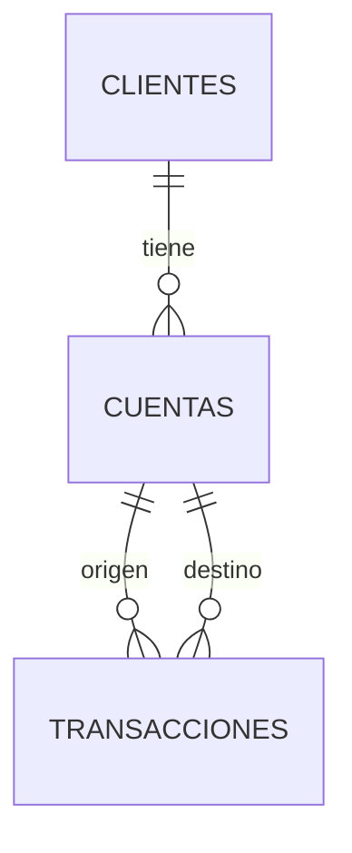

# Actividad 02 — solución corregida

Clientes: cliente_id (PK), nombre, correo, teléfono, fecha_nacimiento, tax_id.

Cuentas: cuenta_id (PK), cliente_id (FK), moneda, tipo_cuenta, saldo_actual, limite_credito.

Transacciones: transaccion_id (PK), from_account (FK a Cuentas), to_account (FK a Cuentas), monto, tipo_transaccion, fecha_completada.

Un cliente tiene muchas cuentas. Cada cuenta tiene un titular en este modelo. Una cuenta puede aparecer como origen o destino de muchas transacciones; son dos relaciones distintas.

## Cambios respecto al intento

Corrijo cardinalidades y separo origen y destino.

[Ver el intento original](original.txt). Las partes ilegibles no se reconstruyen como si hubieran estado en la libreta.

## Referencia

[Clave del profesor — Actividad 02](https://moodle.umsa.edu.mx/mod/resource/view.php?id=21785). Requiere acceso a Moodle.
